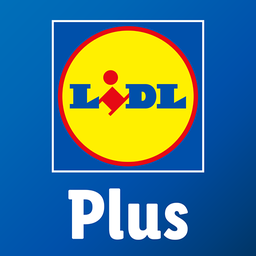

# Lidl Plus (unofficial) — Home Assistant

[![hacs][hacsbadge]][hacs]

Unofficial [HACS](https://hacs.xyz) integration for the **Lidl Plus** app: purchase history and coupons.

Nieoficjalna integracja [HACS](https://hacs.xyz) do programu **Lidl Plus**: historia zakupów i kupony.

**Not affiliated with Lidl or Schwarz Gruppe.** · **Nie jest powiązana z Lidl ani Schwarz Gruppe.**

**Recommended add-on / rekomendowany dodatek:** [Browser Companion](https://github.com/Przemko92/homeassistant-browser-companion) (`https://github.com/Przemko92/homeassistant-browser-companion`) — optional manual sign-in without it (e.g. HA Container / Core) / bez niego opcjonalne logowanie ręczne (np. HA Container / Core)

> 🇬🇧 English below · 🇵🇱 Polski poniżej

---

## 🇬🇧 English

Unofficial integration for **Lidl Plus**. It uses the private API of the mobile app (17.11.6). The terms of service do not cover this — use at your own risk (API changes, account, captcha/MFA).

**Recommended:** [Browser Companion](https://github.com/Przemko92/homeassistant-browser-companion) add-on (HA OS / Supervised). Where it cannot run — e.g. HA Container / Core — the optional manual sign-in described below works instead.

### Installation (HACS)

1. Recommended (Home Assistant OS or Supervised only) — install the **[Browser Companion](https://github.com/Przemko92/homeassistant-browser-companion)** add-on:
   - Settings → Add-ons → Add-on Store → ⋮ → **Repositories**
   - Add `https://github.com/Przemko92/homeassistant-browser-companion`
   - Install **Browser Companion**, start it, and confirm Chromium appears in the sidebar
2. HACS → ⋮ → **Custom repositories**
3. Add this repository, category **Integration**
4. Search **Lidl Plus** → Download → restart Home Assistant
5. Settings → Devices & services → Add integration → **Lidl Plus**

Manual: copy `custom_components/lidl_plus/` to `/config/custom_components/` and restart.

### Sign-in

1. Choose the **country** of your Lidl Plus account. Countries with several languages (Belgium, Switzerland, Luxembourg, …) also ask for a language.
2. Pick how to sign in. The login page has a reCAPTCHA, so a person signs in in a real browser:
   - **Browser Companion — recommended** (Home Assistant OS or Supervised). Browser Companion opens Chromium and waits for **HTTP 302** with `Location: com.lidlplus.app://callback`. Complete captcha, password and MFA in the sidebar browser.
   - **Manual auth code — optional** (any installation; the way to sign in on **Container / Core**, where the add-on cannot run). The integration shows a sign-in link. Open it on a computer, enter your e-mail or phone, then press F12 → Console **before** the last step (password or verification code). After signing in the browser logs `Failed to launch 'com.lidlplus.app://callback?code=…'` — paste that line (or the `com.lidlplus.app://…` address) into the form right away. If the console is empty, the Network tab shows the same address in the `Location` header of the last request.

With Supervisor you get a menu with Browser Companion first and the manual code as an alternative; without Supervisor the manual form opens directly. Re-authentication uses the same steps. To sign in again on demand, use ⋮ → **Reconfigure** on the integration — entities and history stay.

Refresh tokens rotate on every refresh — that is expected. The official app never shows them.

### Entities

| Entity | Description |
| --- | --- |
| Loyalty card | Lidl Plus card number (`loyaltyId`) |
| Last transactions | Amount of the newest ticket; up to 5 tickets in the `transactions` attribute |
| Today's spend | Sum from today's tickets (country time zone) |
| Coupons | How many coupons the app lists, other stores and self-scan included; full list in the `coupons` attribute (each with `summary` and `image_url`) |
| Coupons ready | How many coupons can be activated right now |
| Upcoming coupons | Coupons whose validity window has not started yet |
| Activate coupons | `POST …/v2/promotions/{id}/activation` for each ready coupon |
| Auto coupons | Off by default — when enabled, activates every ready coupon on each refresh |
| Scratch cards | Scratch cards (zdrapki) waiting in the app; per card `expires` and, before scratching, `wins` / `prize_type` (the prize is drawn when the card is made) |
| Scratch cards (button) | `PATCH …/lotteries/{id}/redeemed` for each waiting card, like finishing it in the app |
| Auto scratch cards | Off by default — when enabled, scratches every new card on the next refresh |
| Gift boxes | Secret boxes / daily deals to open (`openGift` home module) |
| Kupon Plus | Amount spent towards the Kupon Plus target; `target`, `missing`, `reward`, `ends` in the attributes |
| Stamp card | Stamps collected on the current stamp card; `units_per_prize`, `completed`, `ends` |
| Deposit refunds | Bottle-deposit money ready to use (system kaucyjny); `pending` and the refunds in the attributes |
| Unread messages | Unread messages in the app's inbox; the home-screen message in `home_message` |
| Store opening hours / Store open | Today's hours of **the store chosen in the app** ("Twój Lidl"; the latest receipt's store only when none is set), with address and the next two weeks in the attributes |
| Shopping lists | Every list of the app's shopping list as a to-do list: add, check, rename and remove items both ways |
| New coupons / New scratch card / Scratch card result / New gift box / New Kupon Plus / New stamp card | Event entities for notifications: one `new` event per item with a ready Polish `summary` (new coupons of one refresh come as a single event; other stores and self-scan are skipped). Items already there when the integration starts are not announced |

Refresh interval: every 15 minutes (integration options: 5–120 min).

Integration options (⚙ Configure): refresh interval, auto coupons, auto scratch cards and **shopping lists** — on by default; when off the integration does not contact the shopping-list service at all and its to-do lists are removed.

Coupons are requested with and without `Store-Id` and merged: with it the server marks the user's store (FavoriteStore), without it it also lists other stores and self-scan coupons. The coupon count therefore matches the app, and the user's store coupons are still activated.

Shopping-list changes made in Home Assistant are read back from the server; if the server did not keep one, the action fails instead of pretending it worked.

**Diagnostics** (⋮ → Download diagnostics) include the raw coupon lists, home modules, scratch cards, deposits, store data and shopping-list items, with tokens, card number and personal data redacted.

### Out of scope for v0.1

Lidl Points, payments, leaflets, self-scanning, invoices, opening gift boxes from Home Assistant.

### API (app 17.11.6)

- Auth: `https://accounts.lidl.com/connect/authorize` and `/connect/token` (OAuth2 PKCE, client `LidlPlusNativeClient`)
- Profile: `https://profile.lidlplus.com/api/v1/{country}/loyalty`
- Tickets: `https://tickets.lidlplus.com/api/v3/{country}/tickets`
- Coupons: `https://coupons.lidlplus.com/app/api/v4/promotionslist`
- Home modules: `https://home.lidlplus.com/configuration/v1/config/{country}` and `POST /api/v2/{country}/home/logged`
- Scratch cards: `https://purchaselottery.lidlplus.com/api/v2/{country}/lotteries/{id}` (`PATCH …/redeemed` to scratch)
- Stores: `https://stores.lidlplus.com/api/v1/users/me/favorite/{country}`, `/v5/{country}/details`, `/v3/schedule/{store}?date=`
- Shopping list: `https://shopping-list.lidlplus.com/api/v4/lists`, sync `PATCH /v5/lists/{id}` (needs `Country` and `Store-Id`)
- Deposits / messages: `https://deposits.lidlplus.com/api/v1/{country}/deposits`, `https://alerts.lidlplus.com/api/v2/{country}/alerts/unread`
- `App-Version: 17.11.6`

### Development / debug

You can test the integration itself (without the add-on) in this repo: Dev Containers → HA on port 8123. **There is no Supervisor** — Browser Companion will not install here.

Details: [`.devcontainer/README.md`](.devcontainer/README.md). Locally without a container: `scripts/setup` then `scripts/develop`. The `config/` directory is in `.gitignore`.

### Support

If this integration helps you, you can buy a coffee: [Buy Me a Coffee](https://buymeacoffee.com/przemko92)

---

## 🇵🇱 Polski

Nieoficjalna integracja do programu **Lidl Plus**. Korzysta z prywatnego API aplikacji mobilnej (17.11.6). Regulamin tego nie przewiduje — używasz na własne ryzyko (zmiany API, konto, captcha/MFA).

**Rekomendowany:** dodatek [Browser Companion](https://github.com/Przemko92/homeassistant-browser-companion) (HA OS / Supervised). Tam, gdzie nie da się go uruchomić — np. na HA Container / Core — działa opcjonalne logowanie ręczne opisane niżej.

### Instalacja (HACS)

1. Rekomendowane (tylko Home Assistant OS albo Supervised) — zainstaluj dodatek **[Browser Companion](https://github.com/Przemko92/homeassistant-browser-companion)**.
2. HACS → ⋮ → **Custom repositories** → dodaj to repozytorium, kategoria **Integration**.
3. Szukaj **Lidl Plus** → Download → restart Home Assistant.
4. Ustawienia → Urządzenia i usługi → Dodaj integrację → **Lidl Plus**.

Ręcznie: skopiuj `custom_components/lidl_plus/` do `/config/custom_components/` i zrestartuj.

### Logowanie

1. Wybierz **kraj** konta Lidl Plus. Kraje z kilkoma językami (Belgia, Szwajcaria, Luksemburg…) pytają też o język.
2. Wybierz sposób logowania. Strona logowania ma reCAPTCHA, więc logować się musi człowiek w prawdziwej przeglądarce:
   - **Browser Companion — rekomendowane** (Home Assistant OS albo Supervised). Browser Companion otwiera Chromium i czeka na **HTTP 302** z `Location: com.lidlplus.app://callback`. Captcha, hasło i MFA robisz w przeglądarce w sidebarze.
   - **Ręczny kod autoryzacji — opcjonalnie** (każda instalacja; sposób logowania na **Container / Core**, gdzie dodatek nie działa). Integracja pokazuje link logowania. Otwórz go na komputerze, wpisz e-mail albo telefon, a **przed** ostatnim krokiem (hasło albo kod weryfikacyjny) naciśnij F12 → Konsola. Po zalogowaniu przeglądarka zapisze `Failed to launch 'com.lidlplus.app://callback?code=…'` — od razu wklej tę linię (albo adres `com.lidlplus.app://…`) do formularza. Jeśli konsola jest pusta, ten sam adres jest w nagłówku `Location` ostatniego żądania w zakładce Sieć.

Z Supervisorem dostajesz menu: najpierw Browser Companion, a ręczny kod jako alternatywa; bez Supervisora od razu otwiera się formularz ręczny. Ponowne logowanie przebiega tak samo. Żeby przelogować się na żądanie, użyj ⋮ → **Skonfiguruj ponownie** przy integracji — encje i historia zostają.

### Encje

| Encja | Opis |
| --- | --- |
| Karta lojalnościowa | Numer karty Lidl Plus |
| Ostatnie transakcje | Kwota ostatniej transakcji; 5 ostatnich w atrybucie `transactions` |
| Dzisiejsze wydatki | Suma z dzisiejszych paragonów (strefa kraju) |
| Kupony | Ile kuponów pokazuje aplikacja, łącznie z innymi sklepami i self-scan; pełna lista w atrybucie `coupons` (każdy z `summary` i `image_url`) |
| Kupony do aktywacji | Ile kuponów można aktywować teraz |
| Kupony przyszłe | Kupony, których ważność jeszcze się nie zaczęła |
| Aktywuj kupony | `POST …/v2/promotions/{id}/activation` dla każdego gotowego kuponu |
| Auto kupony | Domyślnie wyłączone — po włączeniu aktywuje wszystkie gotowe kupony przy odświeżeniu |
| Zdrapki | Zdrapki czekające w aplikacji; przy każdej `expires` oraz — jeszcze przed zdrapaniem — `wins` / `prize_type` (nagroda jest losowana przy tworzeniu zdrapki) |
| Odkryj zdrapki (przycisk) | `PATCH …/lotteries/{id}/redeemed` dla każdej czekającej zdrapki, jak dokończenie jej w aplikacji |
| Auto zdrapki | Domyślnie wyłączone — po włączeniu odkrywa każdą nową zdrapkę przy najbliższym odświeżeniu |
| Prezenty do otwarcia | Sekretne pudełka / prezenty dnia (moduł `openGift` strony głównej) |
| Kupon Plus | Kwota wydana na cel Kuponu Plus; `target`, `missing`, `reward`, `ends` w atrybutach |
| Karta z naklejkami | Naklejki zebrane na bieżącej karcie; `units_per_prize`, `completed`, `ends` |
| Kaucje do wykorzystania | Pieniądze z kaucji gotowe do użycia; `pending` i zwroty w atrybutach |
| Nieprzeczytane wiadomości | Nieprzeczytane wiadomości w aplikacji; komunikat ze strony głównej w `home_message` |
| Godziny otwarcia sklepu / Sklep otwarty | Dzisiejsze godziny **sklepu wybranego w aplikacji** („Twój Lidl”; sklep z ostatniego paragonu tylko, gdy żaden nie jest wybrany), z adresem i najbliższymi dwoma tygodniami w atrybutach |
| Listy zakupów | Każda lista z aplikacji jako lista zadań: dodawanie, odhaczanie, zmiana nazwy i usuwanie w obie strony |
| Nowe kupony / Nowa zdrapka / Zdrapka odkryta / Nowy prezent / Nowy Kupon Plus / Nowa karta z naklejkami | Encje zdarzeń do powiadomień: jedno zdarzenie `new` na pozycję z gotowym `summary` (nowe kupony z jednego odświeżenia przychodzą jako jedno zdarzenie; inne sklepy i self-scan są pomijane). Pozycje istniejące w chwili uruchomienia integracji nie są ogłaszane |

Odświeżanie: co 15 minut (opcje: 5–120 min).

Opcje integracji (⚙ Konfiguruj): interwał odświeżania, auto kupony, auto zdrapki i **listy zakupów** — domyślnie włączone; po wyłączeniu integracja w ogóle nie łączy się z usługą list zakupów, a jej listy zadań znikają.

Kupony są pobierane z nagłówkiem `Store-Id` i bez niego, a wyniki łączone: z nim serwer oznacza sklep użytkownika (FavoriteStore), bez niego pokazuje też inne sklepy i kupony self-scan. Licznik zgadza się więc z aplikacją, a kupony własnego sklepu nadal są aktywowane.

Zmiany listy zakupów z Home Assistanta są ponownie odczytywane z serwera; jeśli serwer jakiejś nie zapisał, akcja kończy się błędem zamiast udawać sukces.

**Diagnostyka** (⋮ → Pobierz diagnostykę) zawiera surowe listy kuponów, moduły strony głównej, zdrapki, kaucje, dane sklepu i produkty list zakupów, z ukrytymi tokenami, numerem karty i danymi osobowymi.

### Poza zakresem v0.1

Punkty Lidl, płatności, gazetki, self-scan, faktury, otwieranie prezentów z Home Assistanta.

### Wsparcie

Jeśli integracja Ci pomaga, możesz postawić kawę: [Buy Me a Coffee](https://buymeacoffee.com/przemko92)

***

[hacs]: https://github.com/hacs/integration
[hacsbadge]: https://img.shields.io/badge/HACS-Custom-orange.svg?style=for-the-badge
